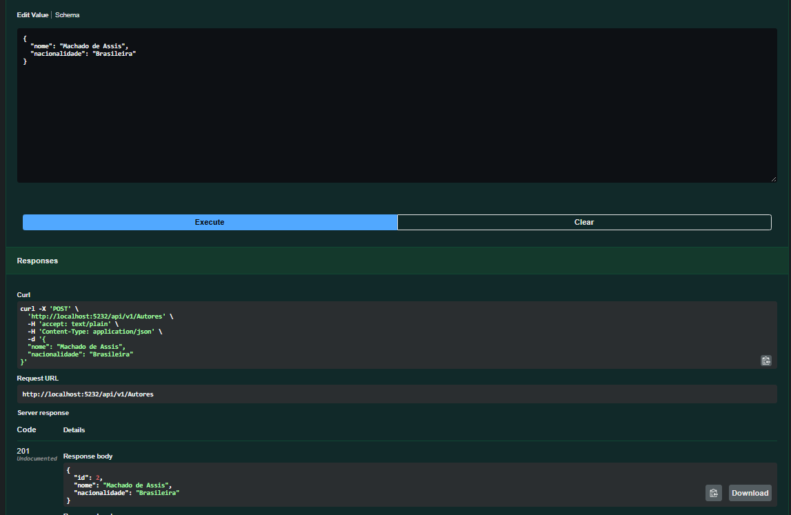
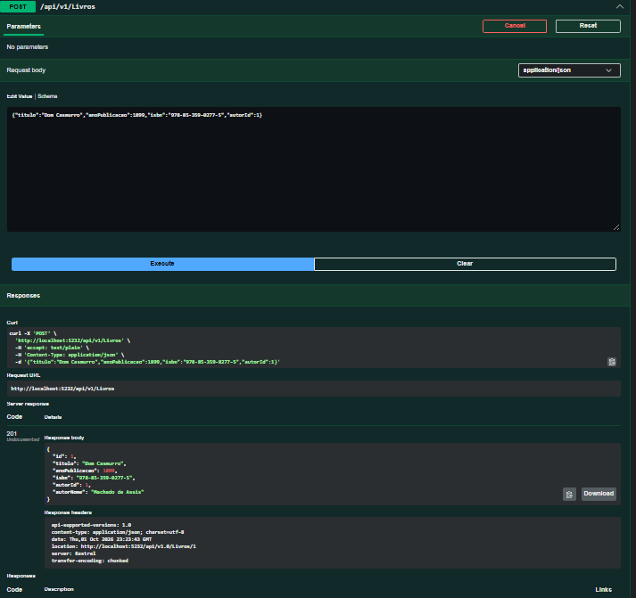
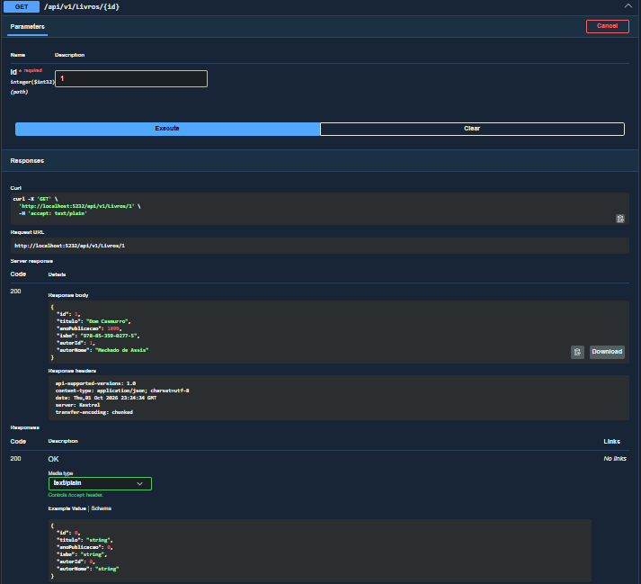
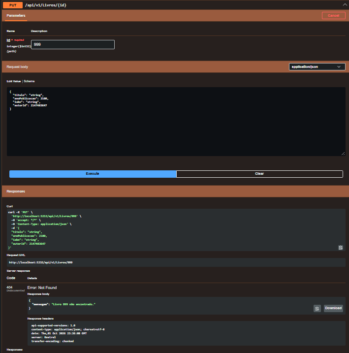
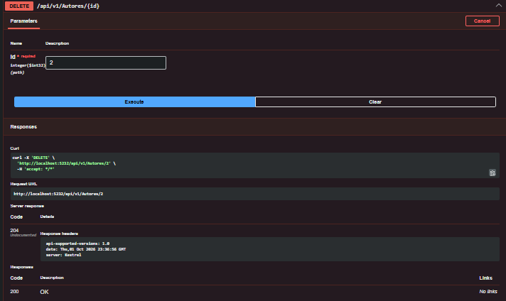
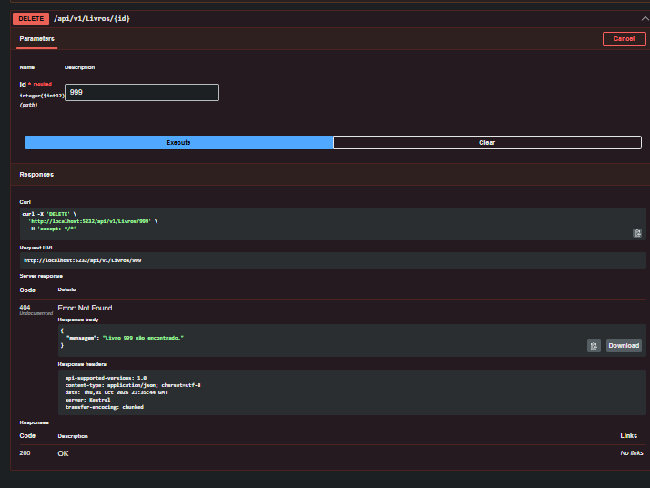

# [Checkpoint 5 - C#] - Biblioteca API

API RESTful desenvolvida em **C# .NET 10** com **Entity Framework Core** para gerenciar autores e livros de uma biblioteca.

## Integrantes do grupo

- [Lucca Natario do Vale] - RM [95688]
- [Thiago Feltrin Geraldes] - RM [555805]
- [Danilo Luz Rios] - RM [554791]

## Contexto do projeto

Bibliotecas pequenas, como as escolares e comunitárias, costumam controlar o acervo em planilhas ou no papel, o que gera registros duplicados e dificulta consultas. Esta API centraliza o cadastro de **autores** e **livros**, permitindo criar, consultar, atualizar e remover registros, mantendo cada livro vinculado ao seu autor.

Destina-se a equipes de bibliotecas e a sistemas (web ou mobile) que precisem consumir os dados do acervo.

## Tecnologias

- C# / .NET 10 (ASP.NET Core Web API com Controllers)
- Entity Framework Core 10 com SQLite
- Asp.Versioning (versionamento por URL)
- Swagger (Swashbuckle) para documentação e testes

## Banco de dados

**SQLite**, em arquivo local (`biblioteca.db`), sem necessidade de instalar servidor. A string de conexão fica em `appsettings.json`.

Relacionamento: um **Autor** possui muitos **Livros** (1:N). Ao excluir um autor, seus livros também são excluídos (cascade).

| Tabela | Colunas |
|---|---|
| Autores | Id, Nome, Nacionalidade |
| Livros | Id, Titulo, AnoPublicacao, Isbn, AutorId (FK) |

## Como rodar localmente

Pré-requisitos: [.NET 10 SDK](https://dotnet.microsoft.com/download) e a ferramenta `dotnet-ef`:

```powershell
dotnet tool install --global dotnet-ef
```

Passos:

```powershell
cd BibliotecaApi
dotnet restore
dotnet ef database update
dotnet run
```

O comando `dotnet ef database update` aplica a migration e cria o arquivo `biblioteca.db`. Depois, abra o Swagger no navegador (a porta aparece no terminal, normalmente `http://localhost:5232`):

```
http://localhost:5232/swagger
```

## Migration

Foi criada a migration `InitialCreate`, que gera as tabelas `Autores` e `Livros`, com a chave estrangeira e o índice em `AutorId`. Os arquivos ficam na pasta `BibliotecaApi/Migrations`.

Comandos usados:

```powershell
dotnet ef migrations add InitialCreate
dotnet ef database update
```

## Versionamento

A API usa versionamento por URL. Todas as rotas começam com `/api/v1/`. As respostas incluem o header `api-supported-versions`.

## Endpoints

### Autores

| Método | Rota | Descrição | Status |
|---|---|---|---|
| GET | `/api/v1/autores` | Lista todos os autores | 200 |
| GET | `/api/v1/autores/{id}` | Busca um autor pelo id | 200, 404 |
| POST | `/api/v1/autores` | Cadastra um autor | 201, 400 |
| PUT | `/api/v1/autores/{id}` | Atualiza um autor | 204, 400, 404 |
| DELETE | `/api/v1/autores/{id}` | Remove um autor e seus livros | 204, 404 |

### Livros

| Método | Rota | Descrição | Status |
|---|---|---|---|
| GET | `/api/v1/livros` | Lista todos os livros | 200 |
| GET | `/api/v1/livros/{id}` | Busca um livro pelo id | 200, 404 |
| POST | `/api/v1/livros` | Cadastra um livro (o autor deve existir) | 201, 400 |
| PUT | `/api/v1/livros/{id}` | Atualiza um livro (o autor deve existir) | 204, 400, 404 |
| DELETE | `/api/v1/livros/{id}` | Remove um livro | 204, 404 |

### Exemplos de corpo (JSON)

Autor:

```json
{
  "nome": "Machado de Assis",
  "nacionalidade": "Brasileira"
}
```

Livro:

```json
{
  "titulo": "Dom Casmurro",
  "anoPublicacao": 1899,
  "isbn": "978-85-359-0277-5",
  "autorId": 1
}
```

## Tratamento de erros

- **400 Bad Request**: dados inválidos (validação por Data Annotations) ou `autorId` inexistente ao cadastrar/atualizar um livro.
- **404 Not Found**: recurso não encontrado, com mensagem descritiva.
- **500**: exceções não tratadas são capturadas por um handler global (`GlobalExceptionHandler`) que devolve um `ProblemDetails` sem expor detalhes internos.

## Estrutura do projeto

```
BibliotecaApi/
├── Controllers/V1/    # AutoresController e LivrosController
├── Data/              # AppDbContext
├── Dtos/              # DTOs de entrada e saída
├── Middleware/        # GlobalExceptionHandler
├── Migrations/        # Migrations do EF Core
├── Models/            # Entidades Autor e Livro
└── Program.cs         # Configuração da aplicação
```

## Evidências de teste

Os testes foram feitos pelo Swagger. As capturas de tela estão na pasta `docs/prints`.

> **Observação:** por serem muitos endpoints e cenários, não foram tiradas capturas de tela de todos. Os prints abaixo mostram uma amostra dos endpoints e dos status retornados. Os demais seguem o mesmo padrão e podem ser executados diretamente pelo Swagger.

**POST autor (201)**


**POST livro (201)**


**GET livro por id (200)**


**PUT livro inexistente (404)**


**DELETE autor (204)**


**DELETE livro (204)**
